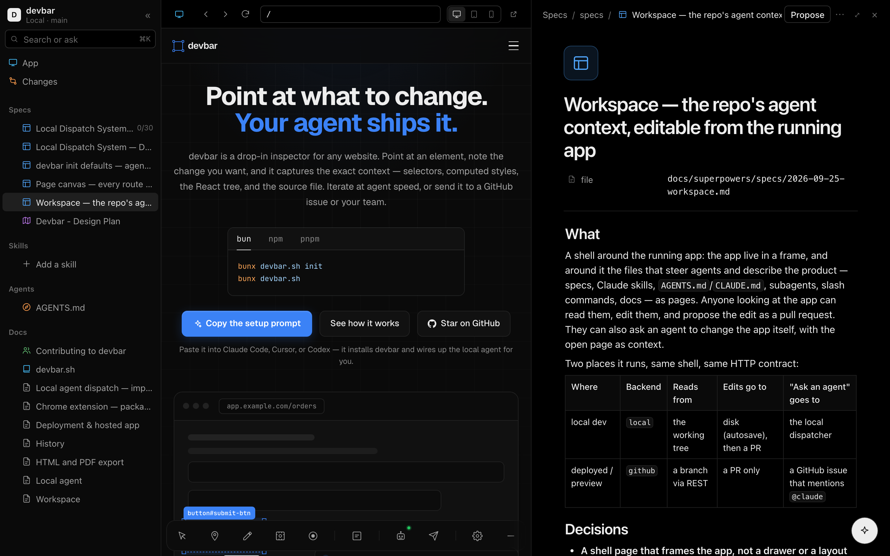

# Workspace

A shell around your running app: the app live in the middle, and around it the
files that describe the product and steer agents — features, knowledge, specs,
Claude skills, `AGENTS.md`/`CLAUDE.md`, subagents, slash commands, docs — as
pages you can read and edit. Anyone looking at the app can change a requirement,
tick off a task, or ask an agent to change the app with the open page as context,
and turn the result into a pull request.



It is laid out like Notion — a sidebar of pages, pages that open beside the app
in a side peek or as a full page, block editing, ⌘K — and set in Vercel's
black and white, with the colour carried by the icons: each kind of page has its
hue (features teal, knowledge sky, specs blue, tasks green, plans purple, skills
amber, agent instructions orange, subagents pink, commands teal), or the emoji
someone picked for it.

## Opening it

Press the book button on the toolbar, or `Alt+W`: the tab turns into the shell,
framing the page you were on. The same button on the framed app's toolbar
(or `Alt+W` there), or **Open app** in the shell's top bar, takes you back out
to wherever the frame is.

The shell is a page of its own, served wherever the Workspace API is:

| Where                                      | Shell URL                                                                 |
| ------------------------------------------ | ------------------------------------------------------------------------- |
| the local devbar server (`bunx devbar.sh`) | `http://127.0.0.1:3100/` — with one project it goes straight to its shell |
| `devbar.sh/next` mounted at `/api/devbar`  | `/api/devbar/shell` (redirect `/devbar` to it for a nicer address)        |

`?url=` says which page to frame. The shell only frames its own host, or — from
the local server — a loopback origin or one a project claims, so it cannot be
used to put another site under this one's name. The shell page itself sends
`frame-ancestors 'none'`: nothing frames the shell.

With no `workspace` prop the toolbar uses the local devbar server's copy of
whichever project claims the page, so a project already running `bunx
devbar.sh` gets the shell with nothing to wire. Point it anywhere else with the
prop:

```tsx
<Devbar workspace="/api/devbar" />  // your own route (below)
<Devbar workspace={false} />        // no book button
```

### The app inside it

The app runs in a frame with a small browser around it: back, forward, reload,
an address bar, and full / tablet (820px) / phone (390px) widths. It is your
app, toolbar and all — annotate it, submit, dispatch, as ever.

The shell and the frame are usually different origins (the local server frames
`localhost:3000`), so neither can see into the other. The toolbar in the app
tells a shell it trusts where the page is — the address bar follows client-side
navigation — and follows its back, forward and reload. It trusts only a shell
served by the app's own origin, the local devbar server, or the workspace
endpoint, and never sends anything but a URL, a title and its theme. The shell
wears that theme — light or dark, whichever the toolbar is showing — rather than
the OS's, and follows it when the app switches. On a page without the toolbar,
back and forward stay disabled, reload re-points the frame, and the shell follows
the OS.

An app that sends `X-Frame-Options: DENY` (or a `frame-ancestors` that excludes
the shell) cannot be framed; the Next.js shell is same-origin, so `SAMEORIGIN`
is fine there.

## Pages

| Sidebar section | Files                                                                                                                                                                                                                                      |
| --------------- | ------------------------------------------------------------------------------------------------------------------------------------------------------------------------------------------------------------------------------------------ |
| Product         | markdown under `product/`: see [Product and knowledge](#product-and-knowledge)                                                                                                                                                             |
| Knowledge       | markdown under `knowledge/`                                                                                                                                                                                                                |
| Specs           | markdown under `specs/`, `docs/specs/`, `.specify/specs/`, `.kiro/specs/`, `docs/superpowers/specs/`, `docs/superpowers/plans/`, `rfcs/`, `docs/rfcs/`; root `SPEC.md`, `PLAN.md`, `ROADMAP.md`, `TODO.md`                                 |
| Skills          | `.claude/skills/<name>/SKILL.md`, `skills/<name>/SKILL.md`                                                                                                                                                                                 |
| Agents          | **Instructions**: `AGENTS.md`, `CLAUDE.md`, `GEMINI.md` at any depth, `.github/copilot-instructions.md`, `.cursor/rules/*.mdc`, `.kiro/steering/`, `.specify/memory/`. **Subagents**: `.claude/agents/`. **Commands**: `.claude/commands/` |
| Docs            | root `README.md`, `CONTRIBUTING.md`, `CHANGELOG.md`; markdown under `docs/`                                                                                                                                                                |

A spec folder — `specs/001-auth/{spec,plan,tasks}.md` — is one page with its
plan and tasks nested beneath it, and `- [ ]` / `- [x]` items show as progress.
`node_modules`, `dist`, `build`, `.next`, `out`, `coverage` and `vendor` are
skipped, and locally only files git would track are listed (untracked ones
included, ignored ones not).

That list is also the edit boundary: the workspace reads and writes these files
and nothing else. It will not open `src/app.ts` for editing, whoever asks. A symlink
counts as where it lands: `CLAUDE.md -> AGENTS.md` works, `docs/x.md -> ../.env`
doesn't. Paths are compared without case for `exclude` and `.git`.

A page opens in a **side peek** beside the app; **⤢** makes it a full page, and
**App** in the sidebar brings the app back. At the top of every page: its icon,
the title, and the frontmatter as **properties** — `status` as a badge,
`description` and the rest as text you can click to change — plus task progress
and the file's path.

**Icons.** Click a page's icon to give it an emoji: pick one from the grid,
filter by name (`rocket`, `bug`, `lock`), or paste any emoji at all. It is
written to the file as frontmatter `icon:` — committed with the page, so
everyone sees it — and a file with no frontmatter gets a small block of its own.
**Remove** takes it out again, and a block left empty goes with it, so the file
reads exactly as it did.

## Product and knowledge

There's nothing to set up. Add a page from the **Product** or **Knowledge** section
of the sidebar, or commit the file yourself, and the folder exists.

`bunx devbar.sh init` adds the rules for agents to `AGENTS.md` (or `CLAUDE.md` when
that's the only one you have). If you already have a `devbar.config.ts`, run it
again: it leaves the config alone, and a run that finds the rules changes nothing.

```
product/                    every file is a feature
  README.md                 the product itself
  search.md
  billing/
    README.md               the Billing feature, parent of the ones below
    checkout.md
knowledge/                  anything else worth knowing, no required shape
  glossary.md
specs/                      agent working documents, as before
```

`product/` says what the app should do, and people own it. `specs/` says how an
agent plans to build one change. `knowledge/` is what you know about the product
that isn't a requirement: decisions, research, notes from calls.

### A feature file

```markdown
---
status: building
owner: tim
pages:
  - /checkout
  - /checkout/[step]
elements:
  - name: Pay button
    selector: '[data-testid="pay"]'
    component: PayButton
knowledge:
  - knowledge/pricing-decisions.md
---

# Checkout

Take payment for what's in the cart, without making anyone create an account.

## Requirements

- [x] Guest checkout with an email address
- [ ] Pay button is disabled while a payment is in flight
```

All of the frontmatter is optional.

| Key         | What                                                                                                                  |
| ----------- | --------------------------------------------------------------------------------------------------------------------- |
| `status`    | `idea`, `planned`, `building`, `shipped` or `dropped`, set by a person. `devbar product check` warns on anything else |
| `owner`     | free text                                                                                                             |
| `pages`     | route patterns: `[id]` is one segment, `[...rest]` one or more, `[[...rest]]` zero or more, `(group)` nothing         |
| `elements`  | each has a `selector`, a React `component` name, or both, and an optional `name`                                      |
| `knowledge` | paths handed to the agent with this feature                                                                           |

A feature's id is its path without the extension: `product/billing/checkout.md` is
`billing/checkout`, `product/billing/README.md` is `billing`, and `product/README.md`
is `.`. A spec points at its feature with `feature: billing/checkout` in its own
frontmatter, and the feature page lists those specs.

`+` beside Product creates a feature in `product/`, or beside the open feature when
one is open, so that's how you get a new one under `billing/`.

### The loop

1. Edit a feature: add a requirement on its page, or annotate an element in the app and press **Add to feature** (the `+`) in the annotations panel. The note becomes an unchecked requirement and the element is added to `elements:`.
2. Press **Build this feature** in the Ask composer. Locally the agent CLI runs; deployed, it opens an issue labelled `devbar-agent`. The prompt names the feature, its routes and its knowledge files.
3. The agent implements the unchecked requirements and ticks each one in the same change as the code.
4. Review the pull request. Merging it is what makes the ticks true on the main branch.

Unchecked requirements are the work queue. Rewording a ticked requirement in a block
unticks it, because the code doesn't do the new text yet. **Edit as markdown** and
edits outside the shell don't get that; they show up in the diff.

That agents only tick boxes in `product/` is an instruction in `AGENTS.md`. Nothing
enforces it.

### What the mapping does

- **On this page**: the sidebar lists the features whose `pages:` match the page the frame is on.
- **Reports**: when the toolbar can read the workspace, a report names the features it touches in a `## Product features` section of its prompt and in `features` in its payload. A feature with `pages:` only matches on those pages, even by component, so a `Button` on another page doesn't pull it in. A workspace that refuses the toolbar's request sends no features.
- **Discuss**: the comment button on an annotation looks for a mapped feature first, then a spec.
- **Show on page**: on a feature page, outlines its selectors in the framed app and marks each **found** or **not found**. It needs the toolbar in the app, and an element with only a `component` isn't checked.

**Add to feature** picks a selector in this order: `data-testid`, `data-test` or
`data-cy`; an `id`; the React component name. A positional selector goes in only when
there's nothing else, and the shell warns you, because the next layout change can
break it.

### Checking links

```bash
bunx devbar.sh product check
```

```
✗ product/b.md: knowledge: knowledge/gone.md does not exist
! product/b.md: status: maybe is not one of idea, planned, building, shipped, dropped
✗ specs/a/spec.md: feature: nope does not exist
2 errors
```

It exits 1 on any `✗`: a `feature:` or `knowledge:` link to a missing file, or
frontmatter that isn't valid YAML. `!` lines are warnings. It reads what git would
track, so it needs a git repository. It can't check selectors, since only a live page
can say whether one matches.

### Existing repositories

Directories you configured in `specs` or `docs` win, so `specs: ["product/specs"]`
stays specs. An unrelated root `product/` folder has its markdown listed as features
and becomes editable through the workspace; set `product: false` to turn that off.

## Editing

Pages are markdown files, edited as blocks. Click any block to edit it in
place; the markdown syntax is lifted out while you type — a to-do edits as a
checkbox and its text, a heading at heading size — and written back when you
leave it. Only that block's lines change; the rest of the file stays
byte-identical.

| Do                                      | To                                                                             |
| --------------------------------------- | ------------------------------------------------------------------------------ |
| click a block                           | edit it                                                                        |
| `/`                                     | turn the block into text, a heading, a to-do, a list, a quote, code, a divider |
| `- ` `[] ` `# ` `1. ` `> ` at the start | the same, as you type                                                          |
| `Enter`                                 | split the block; in a list, start the next item                                |
| `Enter` on an empty item                | end the list                                                                   |
| `Backspace` at the start                | turn it back into text; on an empty block, delete it                           |
| `↑` / `↓` at the edge                   | move to the block above or below                                               |
| hover → `+` / `⋮⋮`                      | add a block below; turn into, duplicate, delete                                |
| click below the last block              | start a new one                                                                |
| tick a checkbox                         | check the task off                                                             |

Code blocks and tables edit as their raw source, and **⋯ → Edit as markdown**
shows the whole file, frontmatter included. The title edits the page's top `#`
heading (or a frontmatter `title:`); a skill's `name:` is its identifier and is
never rewritten for a title.

**Saving.** Locally, a page saves to disk as you type, the way a Notion page
does — the top bar reads _Saving…_ then _Saved_, and your dev server picks the
change up like any other edit. On a GitHub workspace, edits stay drafts until
they are proposed. Drafts live in the browser (localStorage, per endpoint)
until they land, so a reload never loses one.

**New pages.** The `+` beside a sidebar section starts an _Untitled_ page from
a template, placed where the repository already keeps that kind of file. It
takes its file name from the title you give it — `Search` becomes
`specs/search/spec.md` — and saves once it has one.

**Conflicts.** Every read carries the file's git blob sha, and every save and
proposal is checked against it. If the file changed underneath — an agent edited
it, a PR merged — the page says so and offers **Keep my version** (yours, on top
of the new one) or **Use theirs**. Nothing is overwritten silently.

### Shared drafts

Drafts live in one browser's localStorage. A `DraftProvider` backs them with something other people edit too, which is how the paid multiplayer service plugs in. The shell page imports it from a module:

```ts
createWorkspaceRoutes({ shell: { modules: ["/my-drafts.js"] } });
```

```ts
// /my-drafts.js
export const drafts = {
	// Null leaves this page on localStorage drafts.
	open({ path, ref, content, sha, backend }) {
		return {
			ready() {}, // false until content() holds the shared text
			content() {}, // the whole file
			baseSha() {}, // optional: the version the shared text started from, if older than `sha`
			edit(next, base) {}, // apply the change from base to next, not from content() to next
			subscribe(listener) {}, // call it on any change, including your own edit()
			setActiveLine(line) {}, // the file line this person is in, or null
			peers() {}, // [{ id, name, avatarUrl?, line }]
			close() {},
		};
	},
};
```

If you render `<DevbarShell>` yourself, pass `drafts` as a prop. Modules run with the shell's access, so only list code you trust. One that fails to load logs an error and the shell mounts without it.

While a page is shared, the block editor writes on every keystroke, except for an empty block, half a slash command, or text about to split into two blocks. Those go out on blur. A draft already in localStorage goes in once as an edit, if it was based on the same version of the file. Discarding a shared draft discards it for everyone.

Return null for a local workspace on its checkout. It autosaves drafts to disk, so a shared draft would write to everyone's working tree.

## Pull requests

**Propose** on a page (or the **Changes** page, for several at once) opens one
pull request. Locally, pages save as you type, so what gets proposed is the
working tree: the page itself and anything else `git status` reports — source
included, since that is how an agent's edits become a PR. Only files git reports
as changed can be picked, and their content comes from disk, not the browser.

Locally a proposal is built with git plumbing — a scratch index, `hash-object`,
`write-tree`, `commit-tree`, `update-ref` — so your index, working tree and
checked-out branch are never touched. Then:

1. The branch (`devbar/<title>-<id>`) is created on top of `origin/<base>` when
   origin has it, so the PR contains exactly the proposed files and none of your
   unpushed work; otherwise on `HEAD`.
2. It is pushed to `origin` — non-interactively; a push that needs a password
   fails fast rather than hanging.
3. `gh pr create` opens the PR, if `gh` is installed and authenticated.

Each step that cannot happen is reported, not fatal: no `gh` gives you a link to
open the PR yourself, no remote leaves the branch in your repository.

The base branch is `workspace.baseBranch` if set; else the branch you are on,
when origin has it (work on `feat-x` proposes into `feat-x`); else origin's
default branch.

On GitHub a proposal is a tree, a commit, a ref and a pull request through the
REST API. The commit's author is the signed-in user when `authorize` names one
with an email. **Changes** also lists the open PRs from `devbar/` branches (and,
locally, proposal branches that never got one).

## Asking an agent

The button in the corner — and **Ask** in ⌘K — hands a prompt to an agent, with
the open page and the app's current page as context. Suggestions fill it for the
page: **Build this feature** and **Refine this feature**, **Implement this spec**
and **Refine this spec**, **Do the next task** on a `tasks.md`, **Improve this
skill**, **Sync with the code** on a doc.

- **With a local devbar server**, the prompt becomes the task of a report and is
  dispatched to your agent CLI. The shell follows the run until it finishes;
  the agent edits your working tree, and what it changed is waiting under
  **Changes** to propose.
- **On a deployed site** it opens a GitHub issue labelled `devbar-agent`, with
  the prompt, the open file and the page as context. Nothing answers it until
  your repository has something listening. devbar doesn't pick the agent. Run
  any of them from a workflow on that label:

  ```yaml
  # .github/workflows/devbar-agent.yml
  on:
    issues:
      types: [labeled]
  jobs:
    agent:
      if: github.event.label.name == 'devbar-agent'
      runs-on: ubuntu-latest
      permissions:
        contents: write
        pull-requests: write
        issues: write
      steps:
        - uses: actions/checkout@v4
        # Your agent's CLI or action. It reads the issue body and opens a PR.
        - run: your-agent run --prompt "$PROMPT"
          env:
            PROMPT: ${{ github.event.issue.body }}
  ```

  Agents that answer a handle instead of a label need `vibe.mention`, which puts
  it at the top of the body: `vibe: { mention: "@codex" }`. `vibe: false` turns
  asking off. GitHub doesn't start workflows for events made with a workflow's
  own `GITHUB_TOKEN`, so `DEVBAR_GITHUB_TOKEN` has to be a PAT or an app token.

## Keyboard

| Keys    | Does                                            |
| ------- | ----------------------------------------------- |
| `Alt+W` | from the app's toolbar: open or exit the shell  |
| `⌘K`    | search pages, or ask the agent                  |
| `⌘S`    | save the open page now (it saves itself anyway) |
| `⌘\`    | show / hide the sidebar                         |
| `Esc`   | leave the block you are editing; close the peek |

Keys pressed inside the framed app stay with the app.

## Self-hosting with Next.js

```bash
bun add devbar.sh
bunx devbar.sh init --workspace --auth github   # or sso | cloudflare | token | app
```

`init --workspace` writes the route below (into `src/app` or `app`), with the
way in you picked, and prints the variables a production deploy needs —
including a fresh `DEVBAR_SESSION_SECRET` when people sign in. It never
overwrites a route that exists. Outside Next.js it prints the fetch-handler
mount instead. Or by hand:

```ts
// app/api/devbar/[...path]/route.ts
import { createWorkspaceRoutes } from "devbar.sh/next";

export const { GET, POST, OPTIONS } = createWorkspaceRoutes();
```

```tsx
// app/devbar.tsx
"use client";

import { Devbar } from "devbar.sh";
import "devbar.sh/styles.css";

export function DevToolbar() {
	return <Devbar workspace="/api/devbar" />;
}
```

That one route serves the shell too, at `/api/devbar/shell` — the page and the
toolbar's browser bundle it loads, which the package carries inlined, so nothing
is read from disk and nothing extra needs deploying. The shell page is the same
static page for everyone and carries no repository data; every call it makes goes
through the API and its access check.

```ts
// next.config.ts — optional, for a nicer address
export default {
	redirects: async () => [
		{ source: "/devbar", destination: "/api/devbar/shell", permanent: false },
	],
};
```

A redirect rather than a rewrite: the route finds the shell by its own URL.

### The toolbar on a deployed site

Mount it with no environment guard. The workspace decides who sees it:

```tsx
export function DevToolbar() {
	return <Devbar workspace="/api/devbar" />;
}
```

Off localhost it draws nothing and makes no request until one of these turns it
on: `?devbar` in the URL, `Alt+W`, opening the app inside the shell, or a marker in
localStorage from an earlier visit. It then asks `<mount>/info`. If that's a 200,
the toolbar shows and the marker is set. If not, the marker is cleared. A refused
`?devbar` or `Alt+W` goes to the shell's sign-in screen and back to the page; a
refused marker hides the toolbar without a redirect.

**Turn off on this site** in Settings clears the marker and leaves you signed in.

This only decides what to draw. The API checks every request on its own, and the
toolbar's code is public like the rest of your bundle. The toolbar body is a
separate chunk that only loads once it's on, so visitors don't download it. The
stylesheet is still your import: `devbar.sh/styles.css` loads for everyone unless
you put it in a module behind `next/dynamic`.

On a deployed page **Send** takes the place of Submit. It opens a review dialog
with the issue body, and the `devbar-agent` issue is only created once you press
**Open issue**. The dialog says who can read the issue and flags a public
repository. Screenshots are removed, along with field values, emails, card
numbers, tokens and secret-looking URL parameters. That's pattern matching in the
browser, so it won't catch a customer's name in page text. The body is editable
for that reason. Without `vibe`, below `submitPermission`, or when `requireGitHub`
needs a sign-in first, the bar stays on Copy. Reports over 20,000 characters are
refused, and the toast says so.

The site has to be on HTTPS. The annotation tools call `crypto.randomUUID()`,
which browsers only expose in a secure context, so Select does nothing on a plain
`http://` host other than localhost.

The route picks its backend from the environment:

| When                                     | Backend  | Needs                                                   |
| ---------------------------------------- | -------- | ------------------------------------------------------- |
| `NODE_ENV` is `development` or `test`    | `local`  | nothing — serves `process.cwd()` to localhost           |
| anything else, `NODE_ENV` unset included | `github` | `DEVBAR_GITHUB_TOKEN`, and the repository (see below)   |
| `DEVBAR_WORKSPACE_BACKEND=local\|github` | that one | as above; `local` in production has no localhost way in |

| Variable                                             | What                                                                                                |
| ---------------------------------------------------- | --------------------------------------------------------------------------------------------------- |
| `DEVBAR_GITHUB_TOKEN` (or `GITHUB_TOKEN`)            | contents, pull requests and issues **write** on the repository — a fine-grained PAT or an app token |
| `DEVBAR_GITHUB_REPO` (or `GITHUB_REPOSITORY`)        | `owner/name`. On Vercel, `VERCEL_GIT_REPO_OWNER`/`VERCEL_GIT_REPO_SLUG` are used automatically      |
| `DEVBAR_GITHUB_REF`                                  | the branch to read. Default: `VERCEL_GIT_COMMIT_REF`, else the default branch                       |
| `DEVBAR_WORKSPACE_TOKEN`                             | a shared access token (see Access)                                                                  |
| `DEVBAR_WORKSPACE_REQUIRE_GITHUB`                    | `writes` or `all`: people need a GitHub account of their own (see Access)                           |
| `DEVBAR_WORKSPACE_SUBMIT_PERMISSION`                 | the GitHub level needed to submit (see Who can submit)                                              |
| `DEVBAR_OIDC_ISSUER`, `_CLIENT_ID`, `_CLIENT_SECRET` | single sign-on with any OpenID Connect provider (see Access); needs `DEVBAR_SESSION_SECRET`         |
| `DEVBAR_OIDC_ALLOW`                                  | comma-separated emails or `@domains` admitted through single sign-on — required for Google          |
| `DEVBAR_OIDC_LABEL`                                  | the sign-in button's name, e.g. `Okta`. Default `SSO`                                               |

Because the ref defaults to `VERCEL_GIT_COMMIT_REF`, a preview deployment reads
its own branch and proposes into it: reviewers editing a spec on the preview of
`feat-x` open PRs against `feat-x`, not `main`.

Options passed to `createWorkspaceRoutes()` win over the environment:

```ts
createWorkspaceRoutes({
	backend: "github",
	github: { token: () => getInstallationToken(), repo: "acme/site", ref: "main" },
	specs: ["product/specs"],        // replaces the default spec dirs
	docs: ["handbook"],              // replaces the default doc dirs
	exclude: ["handbook/private"],
	baseBranch: "main",
	branchPrefix: "docs/",
	vibe: { mention: "@codex", labels: ["agent"] }, // both optional
	shell: { appUrl: "/" }, // or false to serve the API only
	authorize: async (request) => /* see below */,
});
```

Anything that serves fetch-style handlers can mount the same thing:

```ts
import { createWorkspace } from "devbar.sh/workspace";

const workspace = createWorkspace({ authorize });
app.all("/api/devbar/*", (c) => workspace(c.req.raw)); // Hono
Bun.serve({ fetch: (req) => workspace(req) }); // Bun
```

Routing is by the last path segment, so the mount point is up to you.

## Access

Who may use a workspace, in order:

1. **A bearer token** — `token` or `DEVBAR_WORKSPACE_TOKEN`. The shell asks for
   it once and keeps it in localStorage.
2. **Single sign-on** — a session from the built-in OpenID Connect sign-in
   (below).
3. **`authorize(request)`** — your app's own check. Return the user (`{ name,
   email }`) to allow and attribute, `true` to allow anonymously, or anything
   falsy to refuse. A user returned here is who the PR says proposed it, and the
   commit author when there is an email.

   ```ts
   authorize: async (request) => {
   	const session = await auth.api.getSession({ headers: request.headers });
   	return session ? { name: session.user.name, email: session.user.email } : null;
   },
   ```

4. **A GitHub sign-in** with at least read access to the repository — when
   `authorize` is not set (with it, `authorize` decides and GitHub only says
   whose token acts).
5. **Localhost** — the local backend answers requests whose `Host` is loopback
   and whose `X-Forwarded-For` and `X-Real-IP`, if any, are too. A DNS-rebinding
   page (a hostile name resolving to 127.0.0.1) and a request through a tunnel or
   proxy that sets those headers are refused.

   This only stops browsers and proxies. A route handler can't see the socket, so
   anyone who can reach the port directly can send `Host: localhost` and
   `X-Forwarded-For: 127.0.0.1` themselves. They get the workspace, and locally
   that includes acting through your `gh` account. `next dev` binds `0.0.0.0` by
   default, so on a shared network run it on loopback:

   ```bash
   next dev -H 127.0.0.1
   ```

   Or turn this way in off and use one of the others:
   `createWorkspaceRoutes({ allowLoopback: false, token })`.

With none of them, a deployed workspace refuses everyone.

A cookie session is sealed with `DEVBAR_SESSION_SECRET` and nothing is stored on
the server, so one can't be revoked on its own. Someone removed from your identity
provider stays in until their single sign-on session runs out (12 hours by
default). To end every session now, change the secret. A GitHub sign-in is checked
against the repository at most a minute apart, so removing a collaborator takes
effect within a minute.

### Single sign-on

Google, Okta, Microsoft Entra, Auth0, Keycloak — any OpenID Connect provider,
with the authorization-code flow, PKCE, a state and a nonce; the ID token is
verified against the provider's published keys. Register
`<mount>/sso-callback` as the redirect URI, then:

```bash
DEVBAR_OIDC_ISSUER=https://acme.okta.com
DEVBAR_OIDC_CLIENT_ID=...
DEVBAR_OIDC_CLIENT_SECRET=...
DEVBAR_OIDC_LABEL=Okta
DEVBAR_SESSION_SECRET=...   # 32+ random characters
```

or in code, where `user` decides who gets in and at what level:

```ts
import { allowEmails, createWorkspaceRoutes } from "devbar.sh/next";

createWorkspaceRoutes({
	sso: {
		issuer: "https://accounts.google.com",
		clientId,
		clientSecret,
		secret: process.env.DEVBAR_SESSION_SECRET!,
		label: "Google",
		user: allowEmails(["@acme.com", "contractor@gmail.com"]),
	},
});
```

A company tenant (Okta, Entra) only signs in its own people, so everyone it
signs in is admitted by default. That's only true if the tenant has signups
closed: on an Auth0 or Keycloak tenant with open signups, pass `user`. Google,
Microsoft personal accounts, Apple and GitLab sign in anyone with an account, so
those issuers require an allow-list. Without one the workspace answers 503 rather
than admit the internet. `allowEmails` only counts verified
addresses. A sign-in lasts 12 hours (`maxAgeSeconds`).

People signed in this way act through the server token, like anyone else
without a GitHub account — or sign in with GitHub on top, or are made to (next
section).

### Behind an identity-aware proxy

When something in front of the site already signs people in, trust its signed
JWT — never a bare header, which anyone going around the proxy could set:

```ts
import { anyOf, cloudflareAccess, googleIap, trustedJwt } from "devbar.sh/next";

createWorkspaceRoutes({
	authorize: anyOf(
		cloudflareAccess({ teamDomain: "acme", audience: process.env.CF_ACCESS_AUD! }),
		// googleIap({ audience: "/projects/123/global/backendServices/456" }),
		// trustedJwt({ header: "x-pomerium-jwt-assertion", jwksUrl, issuer, audience }),
		appSession, // your own check, tried after
	),
});
```

Each verifies the signature against the proxy's published keys (RS256/384/512,
ES256/384 — never `none` or HMAC), the issuer, the audience and expiry. Pass
`user: allowEmails([...])` to narrow who gets in, or your own
`(claims) => user | null`. `anyOf` takes the first check that admits.

### Requiring GitHub

Whoever the steps above admit can, by default, propose, comment and open issues
without a GitHub account: the server's token acts for them, and they are
credited by name. To have every change made with a person's own GitHub token —
so GitHub's permissions, branch protection and offboarding apply — require it:

```ts
createWorkspaceRoutes({
	authorize, // still decides who gets in
	requireGitHub: "writes", // or DEVBAR_WORKSPACE_REQUIRE_GITHUB=writes
});
```

| `requireGitHub`   | Someone without a GitHub identity of their own                                                                                   |
| ----------------- | -------------------------------------------------------------------------------------------------------------------------------- |
| `false` (default) | acts through the server token                                                                                                    |
| `"writes"`        | reads; every change answers 403; the shell hides editing, proposing, comments and new issues, and offers **Sign in with GitHub** |
| `"all"`           | is not let in; the shell shows its sign-in screen                                                                                |

Once it's on, the server token never acts for anyone, and GitHub's level replaces
the one `authorize` returned. A reader's proposal goes to GitHub with their token
and comes back refused. An account with no access to the repository doesn't count
as an identity, so a throwaway account gets nothing.

A GitHub identity is a sign-in (`DEVBAR_GITHUB_CLIENT_ID`,
`DEVBAR_GITHUB_CLIENT_SECRET`, `DEVBAR_SESSION_SECRET`), your own
`githubToken(request)`, or locally `gh`'s account. Deployed with neither of the
first two, nothing could satisfy it, so the workspace answers 503 saying what to
set.

### Who can submit

`submitPermission` is the GitHub level needed to open pull requests and issues and
to comment:

```ts
createWorkspaceRoutes({
	submitPermission: "write", // or DEVBAR_WORKSPACE_SUBMIT_PERMISSION=write
});
```

The default is `write` on a public repository, where GitHub gives every account
read, and `read` otherwise. Below `write` the server token acts for the person, so
a reader can still open a PR and start your agent on a private repository. Raise it
if that's not what you want. Someone below the level can still read, and the shell
hides what they can't do.

A reader who gets through still can't set labels, assignees, milestones or
reviewers on the PR, since the server token would be setting what GitHub keeps for
triage. The PR opens without them and the response carries a warning.

People admitted by the shared token, single sign-on or `authorize` count as `write`
unless `authorize` returns a lower `permission`. `permission: "none"`, or a level
that doesn't exist, refuses them. On a public repository, that's
what lets someone in without a GitHub level of their own, so keep that list short.

### What the server token won't do

On top of the levels above, for anyone acting through the server token:

- Replying to or resolving a review thread needs the thread to be on the pull
  request named in the request.
- Deleting a branch only works on `devbar/` branches. Nobody deletes the default
  branch or `baseBranch`.
- `GET pull` gives the diff of a workspace file. For any other file it gives the
  name, and the diff only to someone with a GitHub identity with at least read.
  Files under `exclude` aren't listed to anyone.

A GitHub App's installation token is minted for the configured repository alone. A
PAT reaches whatever it was created for, so give it one repository.

On the local backend, `gh`'s account and git's name belong to whoever owns the
machine: a loopback caller. Someone let in by `authorize`, single sign-on or the
token doesn't use them. They get the level the host granted, capped by what `gh`
could do, and every change needs `write`, because it happens in the owner's working
tree.

### Rate limits

Opening PRs and issues, commenting and reviewing are limited to 30 per 10 minutes
per person, and past that the API answers 429 with `Retry-After`. People without a
verified identity share one count. The local backend has no limit.

```ts
createWorkspaceRoutes({
	rateLimit: { max: 10, windowSeconds: 600 }, // or false
});
```

The count lives in memory, per server instance, so on a serverless deploy each
instance counts on its own. Pass `consume` to use a shared store. It gets the
person's key and returns whether this submit is allowed, and the window is yours to
enforce:

```ts
rateLimit: { consume: (key) => ratelimit.limit(key).then((r) => r.success) },
```

Mutations also need `Content-Type: application/json` and an `Origin` that is
the request's own (or none). That closes the cross-site form and `text/plain`
fetch that would otherwise ride on a signed-in user's cookies. The local devbar
server applies its own origin policy first (loopback origins and the ones a
project claims) and serves pages on other ports, so it skips that second check.

Without `authorize`, names on PRs are whatever the proposer typed, and the PR
says "(self-reported)".

## Configuration

In `devbar.config.ts`, for the local devbar server:

```ts
export default defineConfig({
	workspace: {
		enabled: true, // false: no shell for this project
		product: "product", // the default; a directory, or false to turn it off
		knowledge: "knowledge", // the default; a directory, or false to turn it off
		specs: ["specs", "docs/specs"], // replaces the defaults
		docs: ["docs"], // replaces the defaults
		exclude: ["docs/internal"],
		baseBranch: "main",
		branchPrefix: "devbar/",
		vibe: { mention: "@codex" }, // optional, or false
	},
});
```

The same keys are options of `createWorkspaceRoutes()` / `createWorkspace()`.

## HTTP contract

Relative to wherever the handler is mounted. Errors are `{ error, hint?,
tokenAccepted?, conflicts? }` with a matching status.

| Route          | Body / query                                                                                       | Returns                                                                                                                              |
| -------------- | -------------------------------------------------------------------------------------------------- | ------------------------------------------------------------------------------------------------------------------------------------ |
| `GET shell`    | `?url=`, `?theme=light\|dark`                                                                      | the shell page — no access check, it is static and carries no data                                                                   |
| `GET shell.js` |                                                                                                    | the browser bundle the shell page loads                                                                                              |
| `GET info`     |                                                                                                    | backend, label, ref, base branch, capabilities, `user`                                                                               |
| `GET entries`  |                                                                                                    | `{ entries }`: path, kind, group, title, description, status, tasks, sha; features add pages, elements, knowledge; specs add feature |
| `GET file`     | `?path=`                                                                                           | `{ path, content, sha }`                                                                                                             |
| `POST write`   | `{ files: [{ path, content, baseSha? } \| { path, delete: true }] }`                               | `{ written, shas }` — local only (501 on GitHub)                                                                                     |
| `POST changes` | `{ title, body?, files, author?, pageUrl? }`; files may also be `{ path, fromDisk: true }` locally | `{ branch, commit, pushed, pr?, compareUrl?, warnings }`                                                                             |
| `GET changes`  |                                                                                                    | `{ pulls, branches?, warning? }`                                                                                                     |
| `GET status`   |                                                                                                    | `{ branch, files: [{ path, status }] }` — local only                                                                                 |
| `POST vibe`    | `{ prompt, path?, pageUrl?, author? }`                                                             | `{ issue: { number, url } }` — GitHub only                                                                                           |

On the local devbar server the mount is `/api/projects/<slug>/workspace/`,
`/api/hello` says per project whether it has one (`workspace: true`), and `/`
opens the shell (or lists the projects when there are several).
